# Counted cost versus measured runtime for image-quality metrics (draft)

*Generated by `scripts/complexity/paper.py` from committed tallies, measurements and weight tables; regenerate after any of them changes. Draft: the operation inventory is incomplete and single-counter tallies await independent recounts. Numbers below are what this revision of the inputs gives, nothing more.*

## Question

Can a source-grounded count of operations per pixel, weighted by per-operation costs, predict how long an image-quality metric takes, and which cost table predicts best? If it can, counts compare metrics independently of how much optimization each implementation received; where it cannot, the residual is implementation effect.

## Method

Counting follows the approach of M. Pedzisz (Nokia), *Complexity Assessment of Full-Reference Image Quality Metrics*, a JPEG AIC-4 contribution circulated as a preliminary draft dated 2026-10-07; only part of that draft was seen (screenshots), and no accuracy is claimed for the values transcribed from it. Conventions, halo and parallel-structure extensions: [IQA_COMPLEXITY.md](../IQA_COMPLEXITY.md).

- Tallies: 115 of 115 CLI metric names, counted from zenmetrics source; measured on 105 metrics.
- Measurements: i265 (Intel Core Ultra 7 265K), per-call deltas under `perf stat`, decode and setup excluded, 1024×1024, one content pair, three repeats; 1 thread pinned to a P-core, and 8 threads on P-cores 0-7 from a build with each metric crate's threading enabled.
- Weight tables: flop count; the draft's declared weights; measured scalar throughput and latency on the i265 P-core; LLVM 22 cost model (`print<cost-model>`) for arrowlake and, as a different-CPU control, znver5; llvm-mca per-instruction throughput (`-mcpu=arrowlake` uses the Alder Lake model).
- Halo variants: none; padded domain (W+2h_x)(H+2h_y)/(WH); strip recomputation 1+2h_y/64.
- Statistics: Spearman rank correlation with a 2,000-sample bootstrap 95 % interval; Pearson of logs; a single scale fitted as the median log ratio; residual spread = max/min of residual ratios; typical error = median absolute residual ratio.

## Results

| weights | halo | threads | n | Spearman CPU (95 %) | Pearson log CPU | typical error CPU | spread CPU | Spearman wall |
|---|---|---:|---:|---|---:|---:|---:|---:|
| flop count | none | 1 | 105 | 0.87 (0.80–0.92) | 0.91 | 2.07× | 6188.1× | 0.87 |
| flop count | none | 8 | 106 | 0.88 (0.81–0.93) | 0.93 | 2.13× | 14672.1× | 0.79 |
| flop count | pad | 1 | 105 | 0.86 (0.77–0.92) | 0.91 | 2.36× | 6188.1× | 0.86 |
| flop count | pad | 8 | 106 | 0.87 (0.79–0.93) | 0.93 | 2.43× | 14672.1× | 0.78 |
| flop count | strip64 | 1 | 105 | 0.84 (0.74–0.91) | 0.89 | 2.51× | 6188.1× | 0.84 |
| flop count | strip64 | 8 | 106 | 0.86 (0.77–0.92) | 0.91 | 2.87× | 14672.1× | 0.77 |
| Pedzisz draft weights | none | 1 | 105 | 0.90 (0.82–0.95) | 0.92 | 1.85× | 6180.2× | 0.90 |
| Pedzisz draft weights | none | 8 | 106 | 0.91 (0.83–0.95) | 0.93 | 1.82× | 14584.3× | 0.84 |
| Pedzisz draft weights | pad | 1 | 105 | 0.88 (0.79–0.94) | 0.92 | 1.91× | 6180.2× | 0.88 |
| Pedzisz draft weights | pad | 8 | 106 | 0.89 (0.80–0.94) | 0.93 | 2.01× | 14584.3× | 0.83 |
| Pedzisz draft weights | strip64 | 1 | 105 | 0.85 (0.74–0.92) | 0.89 | 2.25× | 7641.7× | 0.85 |
| Pedzisz draft weights | strip64 | 8 | 106 | 0.86 (0.77–0.93) | 0.91 | 2.41× | 14584.3× | 0.80 |
| measured i265 P-core throughput | none | 1 | 105 | 0.88 (0.79–0.94) | 0.92 | 1.60× | 6151.6× | 0.88 |
| measured i265 P-core throughput | none | 8 | 106 | 0.89 (0.80–0.94) | 0.93 | 1.75× | 14420.0× | 0.81 |
| measured i265 P-core throughput | pad | 1 | 105 | 0.87 (0.77–0.94) | 0.91 | 1.68× | 6151.6× | 0.87 |
| measured i265 P-core throughput | pad | 8 | 106 | 0.88 (0.79–0.94) | 0.92 | 1.66× | 14420.0× | 0.81 |
| measured i265 P-core throughput | strip64 | 1 | 105 | 0.85 (0.73–0.92) | 0.88 | 1.75× | 12321.6× | 0.85 |
| measured i265 P-core throughput | strip64 | 8 | 106 | 0.86 (0.76–0.93) | 0.90 | 1.99× | 14420.0× | 0.79 |
| measured i265 P-core latency | none | 1 | 105 | 0.89 (0.81–0.94) | 0.92 | 1.66× | 6181.0× | 0.89 |
| measured i265 P-core latency | none | 8 | 106 | 0.89 (0.81–0.94) | 0.93 | 1.70× | 14581.4× | 0.83 |
| measured i265 P-core latency | pad | 1 | 105 | 0.87 (0.78–0.93) | 0.92 | 1.74× | 6181.0× | 0.87 |
| measured i265 P-core latency | pad | 8 | 106 | 0.88 (0.79–0.94) | 0.93 | 1.70× | 14581.4× | 0.82 |
| measured i265 P-core latency | strip64 | 1 | 105 | 0.84 (0.73–0.92) | 0.89 | 1.99× | 6181.0× | 0.84 |
| measured i265 P-core latency | strip64 | 8 | 106 | 0.85 (0.75–0.92) | 0.91 | 2.16× | 14581.4× | 0.79 |
| LLVM cost model arrowlake throughput | none | 1 | 105 | 0.88 (0.78–0.94) | 0.91 | 1.60× | 5882.4× | 0.88 |
| LLVM cost model arrowlake throughput | none | 8 | 106 | 0.88 (0.79–0.94) | 0.92 | 1.66× | 13826.8× | 0.82 |
| LLVM cost model arrowlake throughput | pad | 1 | 105 | 0.86 (0.76–0.93) | 0.91 | 1.70× | 5882.4× | 0.86 |
| LLVM cost model arrowlake throughput | pad | 8 | 106 | 0.87 (0.78–0.94) | 0.92 | 1.69× | 13826.8× | 0.82 |
| LLVM cost model arrowlake throughput | strip64 | 1 | 105 | 0.83 (0.71–0.92) | 0.87 | 2.08× | 11643.8× | 0.83 |
| LLVM cost model arrowlake throughput | strip64 | 8 | 106 | 0.85 (0.74–0.92) | 0.89 | 2.03× | 13826.8× | 0.79 |
| LLVM cost model arrowlake latency | none | 1 | 105 | 0.86 (0.75–0.93) | 0.89 | 1.77× | 5417.0× | 0.86 |
| LLVM cost model arrowlake latency | none | 8 | 106 | 0.86 (0.76–0.94) | 0.91 | 1.77× | 12387.1× | 0.80 |
| LLVM cost model arrowlake latency | pad | 1 | 105 | 0.85 (0.73–0.93) | 0.88 | 1.73× | 9108.3× | 0.85 |
| LLVM cost model arrowlake latency | pad | 8 | 106 | 0.85 (0.74–0.93) | 0.90 | 1.75× | 12387.1× | 0.79 |
| LLVM cost model arrowlake latency | strip64 | 1 | 105 | 0.81 (0.69–0.91) | 0.83 | 1.94× | 31928.8× | 0.82 |
| LLVM cost model arrowlake latency | strip64 | 8 | 106 | 0.83 (0.71–0.92) | 0.86 | 2.18× | 34150.7× | 0.77 |
| llvm-mca arrowlake (ADLP) throughput | none | 1 | 105 | 0.87 (0.77–0.93) | 0.91 | 1.50× | 6163.4× | 0.87 |
| llvm-mca arrowlake (ADLP) throughput | none | 8 | 106 | 0.87 (0.77–0.93) | 0.92 | 1.73× | 14559.2× | 0.81 |
| llvm-mca arrowlake (ADLP) throughput | pad | 1 | 105 | 0.85 (0.75–0.93) | 0.91 | 1.59× | 6163.4× | 0.86 |
| llvm-mca arrowlake (ADLP) throughput | pad | 8 | 106 | 0.86 (0.76–0.93) | 0.92 | 1.68× | 14559.2× | 0.81 |
| llvm-mca arrowlake (ADLP) throughput | strip64 | 1 | 105 | 0.82 (0.70–0.91) | 0.88 | 1.73× | 6163.4× | 0.82 |
| llvm-mca arrowlake (ADLP) throughput | strip64 | 8 | 106 | 0.84 (0.72–0.92) | 0.90 | 1.99× | 14559.2× | 0.78 |
| LLVM cost model znver5 throughput (other CPU) | none | 1 | 105 | 0.88 (0.78–0.94) | 0.92 | 1.65× | 5881.6× | 0.88 |
| LLVM cost model znver5 throughput (other CPU) | none | 8 | 106 | 0.89 (0.80–0.95) | 0.93 | 1.65× | 13826.8× | 0.83 |
| LLVM cost model znver5 throughput (other CPU) | pad | 1 | 105 | 0.86 (0.76–0.93) | 0.91 | 1.62× | 5881.6× | 0.86 |
| LLVM cost model znver5 throughput (other CPU) | pad | 8 | 106 | 0.87 (0.78–0.94) | 0.92 | 1.75× | 13826.8× | 0.82 |
| LLVM cost model znver5 throughput (other CPU) | strip64 | 1 | 105 | 0.83 (0.71–0.92) | 0.87 | 2.01× | 10758.4× | 0.83 |
| LLVM cost model znver5 throughput (other CPU) | strip64 | 8 | 106 | 0.85 (0.74–0.92) | 0.89 | 2.07× | 13826.8× | 0.79 |

### Figures

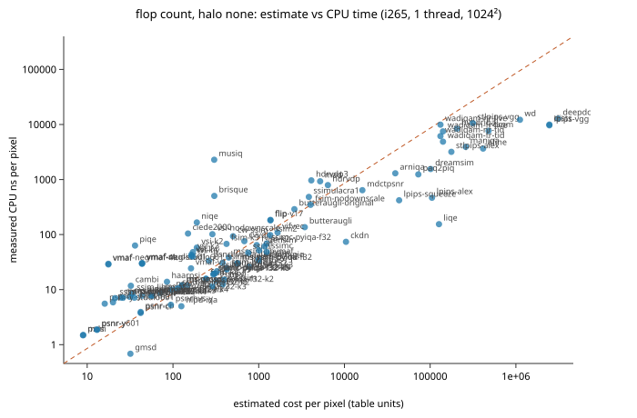

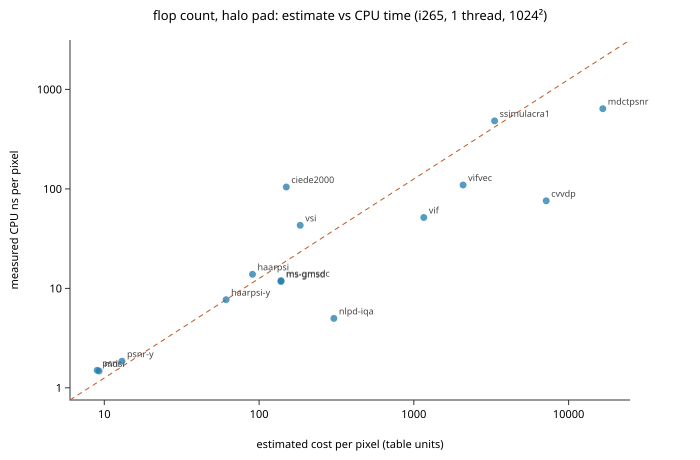

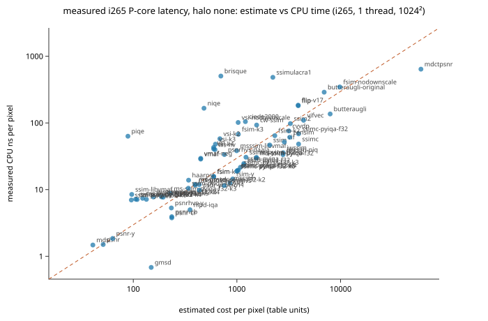

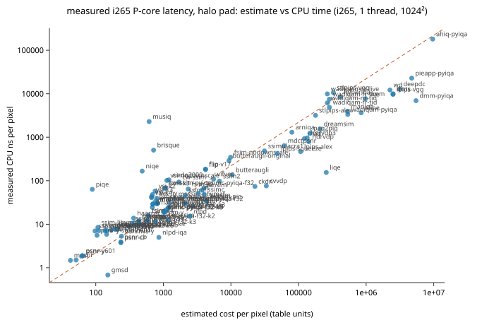

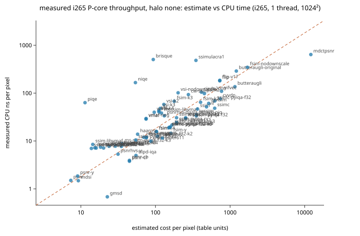

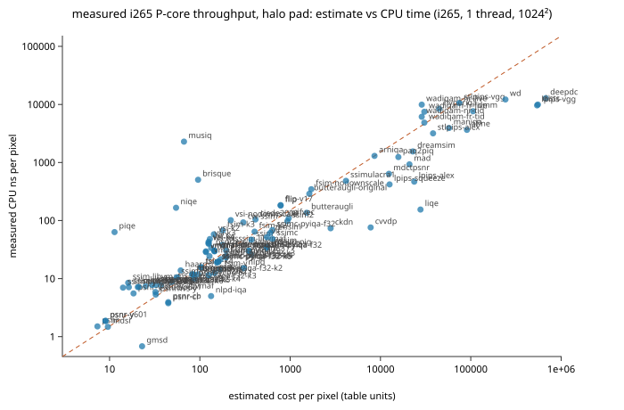

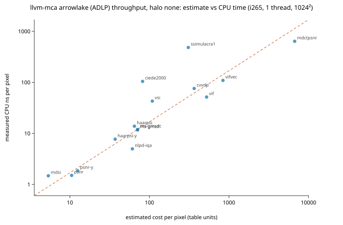

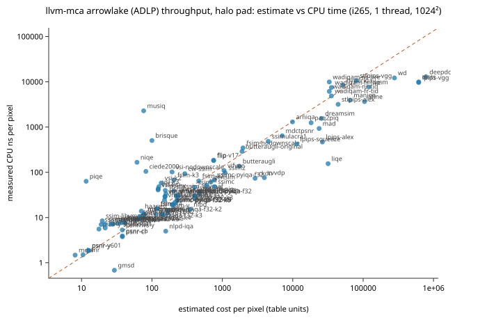

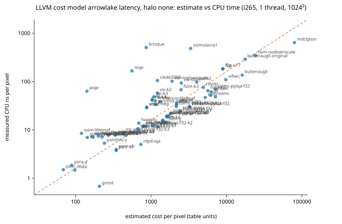

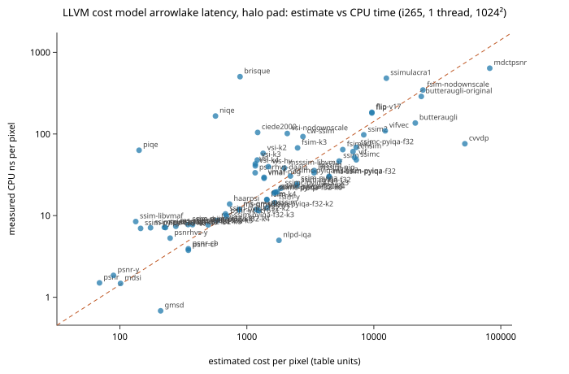

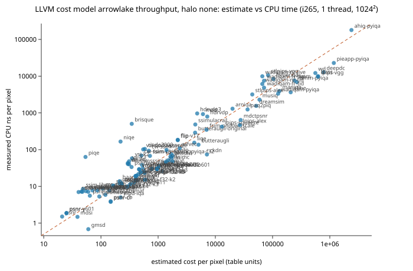

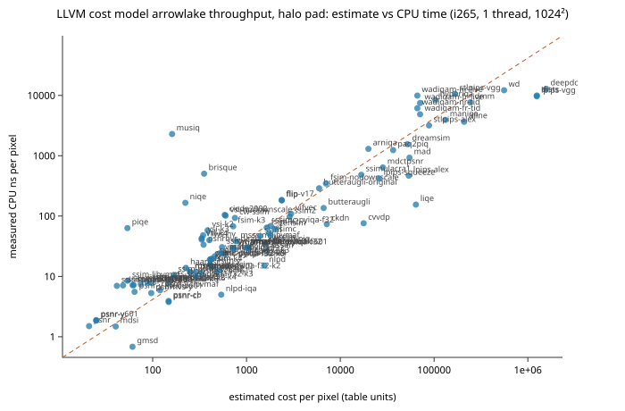

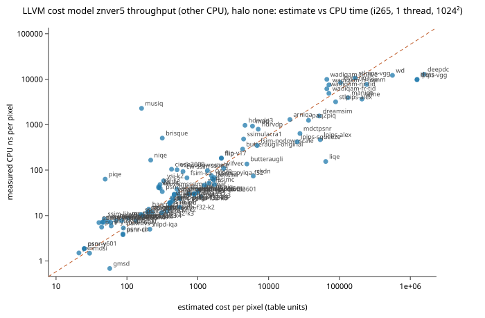

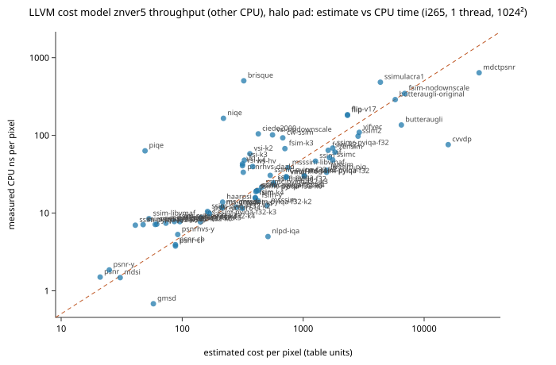

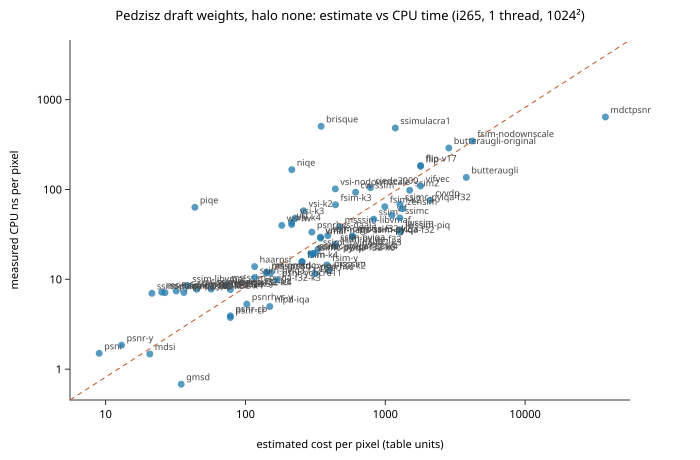

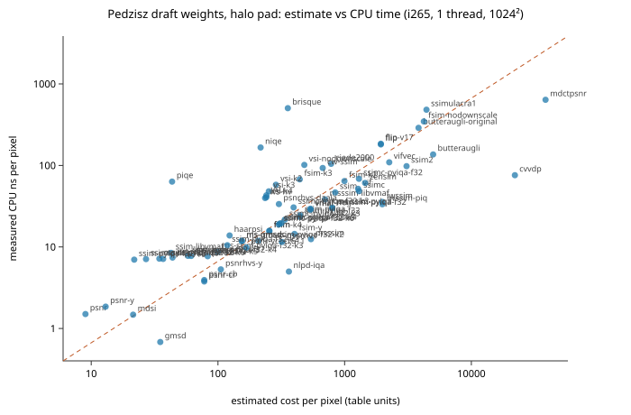

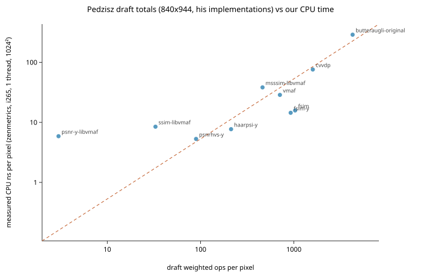

### The draft's own totals against our measured time

10 metrics overlap. Spearman 0.83 (0.38–0.99), typical error 1.51×, spread 127.9×. The draft counted third-party reference or production implementations (libvmaf, Google butteraugli, the FSIM MATLAB code, HaarPSI Python, ColorVideoVDP PyTorch) at 840×944; DVIFM, the only one written by its author, has no zenmetrics counterpart here. So this compares two independent things: counts of reference code, and the runtime of zenmetrics code.

## Pareto front: complexity vs agreement with subjective scores

Agreement: mean within-source Spearman correlation between each published AIC2026 metric column and the preliminary subjective JND reconstruction for the public split (5,768 images, 42 sources), with a bootstrap interval over sources. Within-source correlation avoids rewarding a metric for ranking different contents against each other. These scores come from the implementations the dataset authors ran; the complexity axis is our implementation of the same method (mapping: `scripts/complexity/aic2026_columns.json`). The subjective data is preliminary. Application classes are not formally defined; the front only shows which metrics no other metric beats on both axes.

Pareto-optimal against single-thread CPU time: gmsd, nlpd-iqa, haarpsi, ssim2.
Against 8-thread CPU time: gmsd, nlpd-iqa, haarpsi, ssim2.
Against tallied cost (measured-throughput weights): psnr, ssim-libvmaf, gmsd, nlpd-iqa, haarpsi, ssim2.

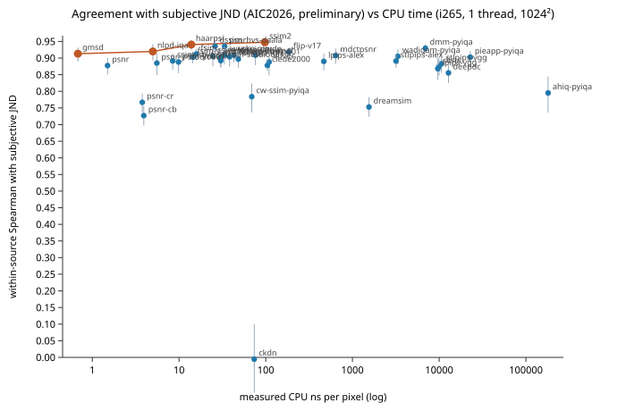

| metric | AIC column | agreement (95 %) | pooled abs. Spearman | CPU ns/px 1t | CPU ns/px 8t | tallied cost | front |
|---|---|---|---:|---:|---:|---:|---|
| ssim2 | SSIMULACRA2 | 0.948 (0.937–0.957) | 0.898 | 97.79 | 162.5 | 452.5 | ★ |
| haarpsi | HaarPSI | 0.941 (0.924–0.954) | 0.911 | 13.85 | 20.93 | 57.68 | ★ |
| butteraugli | proposal-Butteraugli | 0.936 (0.921–0.948) | 0.926 | 136.2 | 198 | 1161 |  |
| dssim | DSSIM | 0.936 (0.916–0.952) | 0.848 | 26.06 | 34.52 | 263.7 |  |
| psnrhvs-daala | PSNR-HVS | 0.936 (0.918–0.951) | 0.878 | 33.55 | 34.12 | 131.4 |  |
| dmm | DMM | 0.930 (0.917–0.941) | 0.846 | 7646 | 8082 | 1.055e+05 |  |
| hdrvdp | HDR_VDP_2 | 0.920 (0.896–0.941) | 0.813 | – | – | 2358 |  |
| nlpd-iqa | NLPD | 0.920 (0.893–0.942) | 0.706 | 4.989 | 7.793 | 54.81 | ★ |
| flip-v17 | FLIP | 0.918 (0.903–0.931) | 0.742 | 184.8 | 186.9 | 726.2 |  |
| gmsd | GMSD | 0.913 (0.889–0.932) | 0.889 | 0.6821 | 0.8448 | 22.66 | ★ |
| fsim | FSIMc | 0.912 (0.895–0.927) | 0.706 | 15.79 | 25.71 | 103 |  |
| hdrvdp3 | HDR_VDP_3 | 0.912 (0.883–0.936) | 0.655 | – | – | 2102 |  |
| iwssim-piq | IW-SSIM | 0.910 (0.881–0.935) | 0.809 | 33.42 | 47.53 | 354.9 |  |
| cvvdp | CVVDP | 0.909 (0.878–0.936) | 0.824 | 75.95 | 98.67 | 739.6 |  |
| vsi | VSI | 0.909 (0.887–0.926) | 0.726 | 43.01 | 59.13 | 111.2 |  |
| mdctpsnr | mDCT-PSNR | 0.908 (0.882–0.929) | 0.767 | 639.4 | 1193 | 1.208e+04 |  |
| ssim-pyiqa | SSIM-pyiqa | 0.906 (0.876–0.930) | 0.547 | 24.56 | 23.66 | 191.7 |  |
| msssim-libvmaf | MS-SSIM | 0.904 (0.875–0.929) | 0.709 | 38.29 | 53.92 | 120.2 |  |
| fsim-y | FSIM | 0.903 (0.884–0.920) | 0.697 | 14.44 | 33.13 | 160.1 |  |
| pieapp | PieAPP | 0.903 (0.881–0.921) | 0.855 | – | 5.476e+05 | 1.659e+08 |  |
| ms-ssim-pyiqa | MS-SSIM-pyiqa | 0.901 (0.871–0.927) | 0.711 | 30.39 | 29.38 | 253.9 |  |
| vmaf-neg | VMAF-neg | 0.901 (0.883–0.916) | 0.874 | 29.48 | 29.44 | 74.79 |  |
| ssimc | SSIMc | 0.897 (0.871–0.920) | 0.553 | 48.3 | 47.97 | 622.3 |  |
| vmaf | VMAF | 0.892 (0.873–0.908) | 0.865 | 28.7 | 28.77 | 74.79 |  |
| ssim-libvmaf | SSIM | 0.891 (0.864–0.914) | 0.591 | 8.464 | 11.11 | 14.46 |  |
| stlpips-alex | STLPIPS | 0.891 (0.871–0.910) | 0.746 | 3177 | 3530 | 3.825e+04 |  |
| lpips-alex | LPIPS-alex | 0.890 (0.864–0.914) | 0.616 | 467.3 | 505.4 | 2.365e+04 |  |
| psnr-ycbcr611 | PSNR-YCbCr611 | 0.888 (0.855–0.917) | 0.610 | 9.869 | 9.702 | 86.76 |  |
| vifvec | VIF | 0.888 (0.848–0.923) | 0.833 | 109.4 | 159.2 | 768.1 |  |
| psnr-y-studio601 | PSNR-Y | 0.885 (0.849–0.915) | 0.608 | 5.556 | 5.48 | 18.44 |  |
| stlpips-vgg | STLPIPS-VGG | 0.883 (0.856–0.905) | 0.588 | 1.06e+04 | 1.181e+04 | 7.465e+04 |  |
| ciede2000 | CIEDE2000 | 0.878 (0.862–0.892) | 0.452 | 104.5 | 104.9 | 412.8 |  |
| psnr | PSNR | 0.877 (0.850–0.901) | 0.592 | 1.502 | 1.48 | 7.344 |  |
| dists | DISTS | 0.875 (0.848–0.899) | 0.758 | 9962 | 1.097e+04 | 5.534e+05 |  |
| lpips-vgg | LPIPS-VGG | 0.868 (0.835–0.899) | 0.636 | 9656 | 1.07e+04 | 5.426e+05 |  |
| deepdc | DeepDC | 0.856 (0.825–0.883) | 0.676 | 1.281e+04 | 1.377e+04 | 6.75e+05 |  |
| ahiq | AHIQ | 0.795 (0.736–0.845) | 0.507 | – | – | 2.537e+05 |  |
| cw-ssim | CW-SSIM | 0.784 (0.737–0.823) | 0.489 | 93.02 | 89.84 | 276 |  |
| psnr-cr | PSNR-Cr | 0.767 (0.737–0.794) | 0.483 | 3.768 | 3.723 | 44.8 |  |
| dreamsim | DreamSim | 0.753 (0.724–0.782) | 0.637 | 1551 | 1853 | 2.265e+04 |  |
| psnr-cb | PSNR-Cb | 0.727 (0.697–0.756) | 0.413 | 3.93 | 3.932 | 44.8 |  |
| cambi | CAMBI | 0.371 (0.280–0.458) | 0.252 | 11.73 | 15.73 | 41.63 |  |
| ckdn | CKDN | -0.005 (-0.106–0.100) | 0.054 | 73.75 | 103.2 | 2786 |  |

## Where the work is

Share of each metric's flops by access class (separable 1-D passes vs 2D windows computed directly, transforms, network layers), and bytes written per pixel to fully materialized planes (`materialize` = `full`; "unknown" until the tally records it). From the tallies at 1024×1024.

| metric | flops/px | separable passes | 2D stencils | transforms | network layers | pointwise / reductions | resampling | other | full-materialized B/px | unannotated B/px |
|---|---:|---:|---:|---:|---:|---:|---:|---:|---:|---:|
| pieapp | 7.658e+08 | 0% | 0% | 0% | 0% | 0% | 0% | 100% | 0 | 0 |
| deepdc | 3.112e+06 | 0% | 0% | 0% | 0% | 0% | 0% | 100% | 24 | 0 |
| dists | 2.454e+06 | 0% | 0% | 0% | 0% | 0% | 0% | 100% | 24 | 0 |
| lpips-vgg | 2.452e+06 | 0% | 0% | 0% | 0% | 0% | 0% | 100% | 24 | 0 |
| ahiq | 1.138e+06 | 0% | 0% | 0% | 0% | 0% | 0% | 100% | 0 | 0 |
| wd | 1.114e+06 | 0% | 0% | 0% | 0% | 0% | 0% | 100% | 24 | 0 |
| dmm | 4.804e+05 | 0% | 0% | 0% | 0% | 0% | 0% | 100% | 0 | 0 |
| afine | 4.148e+05 | 0% | 0% | 0% | 0% | 0% | 0% | 100% | 0 | 0 |
| stlpips-vgg | 3.145e+05 | 0% | 0% | 0% | 0% | 0% | 0% | 100% | 24 | 0 |
| maniqa | 2.601e+05 | 0% | 0% | 0% | 0% | 0% | 0% | 100% | 0 | 0 |
| hyperiqa | 2.051e+05 | 0% | 0% | 0% | 0% | 0% | 0% | 100% | 0 | 0 |
| stlpips-alex | 1.765e+05 | 0% | 0% | 0% | 0% | 0% | 0% | 100% | 24 | 0 |
| wadiqam-fr-live | 1.41e+05 | 0% | 0% | 0% | 0% | 0% | 0% | 100% | 0 | 0 |
| wadiqam-fr-tid | 1.41e+05 | 0% | 0% | 0% | 0% | 0% | 0% | 100% | 0 | 0 |
| wadiqam-nr-live | 1.318e+05 | 0% | 0% | 0% | 0% | 0% | 0% | 100% | 0 | 0 |
| wadiqam-nr-tid | 1.318e+05 | 0% | 0% | 0% | 0% | 0% | 0% | 100% | 0 | 0 |
| liqe | 1.267e+05 | 0% | 0% | 0% | 0% | 0% | 0% | 100% | 0 | 0 |
| lpips-alex | 1.049e+05 | 0% | 0% | 0% | 0% | 0% | 0% | 100% | 24 | 0 |
| dreamsim | 1.012e+05 | 0% | 0% | 0% | 0% | 0% | 0% | 100% | 0 | 0 |
| paq2piq | 7.273e+04 | 0% | 0% | 0% | 0% | 0% | 0% | 100% | 0 | 0 |
| lpips-squeeze | 4.341e+04 | 0% | 0% | 0% | 0% | 0% | 0% | 100% | 24 | 0 |
| arniqa | 3.923e+04 | 0% | 0% | 0% | 0% | 0% | 0% | 100% | 0 | 0 |
| mdctpsnr | 1.619e+04 | 56% | 2% | 31% | 0% | 11% | 0% | 0% | 7601 | 0 |
| ckdn | 1.043e+04 | 0% | 0% | 0% | 0% | 0% | 0% | 100% | 0 | 0 |
| hdrvdp | 6403 | 0% | 46% | 43% | 0% | 3% | 7% | 0% | 357.3 | 0 |
| mad | 5211 | 1% | 0% | 96% | 0% | 0% | 0% | 3% | 657.2 | 0 |
| hdrvdp3 | 4108 | 0% | 23% | 68% | 0% | 3% | 6% | 0% | 457.1 | 0 |
| fsim-nodownscale | 4029 | 0% | 2% | 0% | 0% | 6% | 92% | 0% | 0 | 0 |
| ssimulacra1 | 3846 | 96% | 0% | 0% | 0% | 3% | 0% | 0% | 396.9 | 0 |
| butteraugli-gpu | 3840 | 56% | 0% | 0% | 0% | 44% | 0% | 0% | 0 | 0 |
| butteraugli | 3447 | 54% | 31% | 0% | 0% | 15% | 0% | 0% | 964 | 0 |
| butteraugli-original | 2610 | 49% | 0% | 0% | 0% | 18% | 0% | 33% | 448 | 0 |
| vifvec | 1657 | 0% | 55% | 0% | 0% | 2% | 6% | 37% | 107.9 | 0 |
| flip | 1371 | 95% | 0% | 0% | 0% | 5% | 0% | 0% | 116 | 0 |
| flip-v17 | 1371 | 95% | 0% | 0% | 0% | 5% | 0% | 0% | 116 | 0 |
| ssim2 | 1364 | 66% | 0% | 0% | 0% | 33% | 1% | 0% | 236 | 0 |
| ssimc | 1240 | 100% | 0% | 0% | 0% | 0% | 0% | 0% | 240 | 0 |
| ssimc-pyiqa-f32 | 1240 | 100% | 0% | 0% | 0% | 0% | 0% | 0% | 240 | 0 |
| zensim | 1169 | 64% | 11% | 0% | 0% | 25% | 0% | 0% | 0 | 0 |
| ssim2-gpu | 1048 | 73% | 0% | 0% | 0% | 27% | 1% | 0% | 0 | 0 |
| vif | 1013 | 99% | 0% | 0% | 0% | 1% | 0% | 0% | 207.5 | 0 |
| iwssim | 1005 | 30% | 41% | 0% | 0% | 23% | 5% | 0% | 87.4 | 0 |
| iwssim-piq | 1005 | 30% | 41% | 0% | 0% | 23% | 5% | 0% | 87.4 | 0 |
| iwssim-gpu | 987 | 33% | 4% | 0% | 0% | 62% | 0% | 0% | 0 | 0 |
| zensim-gpu | 950.6 | 0% | 91% | 0% | 0% | 9% | 0% | 0% | 0 | 0 |
| fsim-k2 | 949.2 | 0% | 2% | 0% | 0% | 9% | 89% | 0% | 0 | 0 |
| dssim | 772.6 | 71% | 0% | 0% | 0% | 28% | 1% | 0% | 271.7 | 0 |
| ssim | 756.3 | 89% | 0% | 0% | 0% | 11% | 0% | 0% | 0 | 0 |
| cvvdp-gpu | 690.7 | 36% | 19% | 0% | 0% | 45% | 0% | 0% | 0 | 0 |
| cvvdp | 680 | 30% | 0% | 0% | 0% | 38% | 27% | 5% | 192 | 0 |
| dssim-gpu | 658.8 | 0% | 80% | 0% | 0% | 19% | 1% | 0% | 0 | 0 |
| ms-ssim-pyiqa | 564.5 | 98% | 0% | 0% | 0% | 2% | 0% | 0% | 127.9 | 0 |
| ms-ssim-pyiqa-f32 | 564.5 | 98% | 0% | 0% | 0% | 2% | 0% | 0% | 127.9 | 0 |
| cw-ssim | 502 | 0% | 0% | 87% | 0% | 11% | 0% | 2% | 275.6 | 0 |
| msssim-libvmaf | 447.9 | 65% | 0% | 0% | 0% | 11% | 24% | 0% | 73.92 | 0 |
| ssim-pyiqa | 425.4 | 98% | 0% | 0% | 0% | 2% | 0% | 0% | 96 | 0 |
| ssim-pyiqa-f32 | 425.4 | 98% | 0% | 0% | 0% | 2% | 0% | 0% | 96 | 0 |
| fsim-k3 | 421.4 | 0% | 2% | 0% | 0% | 13% | 85% | 0% | 0 | 0 |
| nlpd | 397.9 | 0% | 70% | 0% | 0% | 5% | 25% | 0% | 47.99 | 0 |
| msssim | 381.6 | 97% | 0% | 0% | 0% | 3% | 1% | 0% | 10.66 | 0 |
| ssimc-pyiqa-f32-k2 | 380 | 100% | 0% | 0% | 0% | 0% | 0% | 0% | 80 | 0 |
| ssimc-pyiqa-f32-k3 | 326.9 | 100% | 0% | 0% | 0% | 0% | 0% | 0% | 80 | 0 |
| fsim-y | 320.2 | 0% | 1% | 82% | 0% | 16% | 0% | 0% | 131.5 | 0 |
| ssimc-pyiqa-f32-k4 | 308.6 | 100% | 0% | 0% | 0% | 0% | 0% | 0% | 80 | 0 |
| brisque | 303.3 | 0% | 81% | 0% | 0% | 19% | 0% | 0% | 0 | 0 |
| musiq | 302.8 | 0% | 0% | 0% | 0% | 100% | 0% | 0% | 0 | 0 |
| ssimc-pyiqa-f32-k5 | 300 | 100% | 0% | 0% | 0% | 0% | 0% | 0% | 80 | 0 |
| ssimc-pyiqa-f32-k6 | 295.6 | 100% | 0% | 0% | 0% | 0% | 0% | 0% | 80 | 0 |
| vsi-nodownscale | 288.6 | 10% | 26% | 17% | 0% | 27% | 20% | 0% | 182.5 | 0 |
| psnrhvs | 288.6 | 0% | 0% | 0% | 0% | 0% | 0% | 100% | 24.3 | 0 |
| psnrhvs-daala | 262.5 | 0% | 0% | 0% | 0% | 18% | 0% | 82% | 6.39 | 0 |
| fsim | 243.1 | 0% | 2% | 0% | 0% | 19% | 79% | 0% | 0 | 0 |
| fsim-k4 | 243.1 | 0% | 2% | 0% | 0% | 19% | 79% | 0% | 0 | 0 |
| vsi-k2 | 189.9 | 9% | 10% | 26% | 0% | 25% | 31% | 0% | 108.5 | 0 |
| niqe | 189.8 | 0% | 97% | 0% | 0% | 3% | 0% | 0% | 0 | 0 |
| vsi-k3 | 170.9 | 8% | 5% | 29% | 0% | 24% | 34% | 0% | 91.89 | 0 |
| ws-hv | 170.5 | 0% | 0% | 6% | 0% | 15% | 79% | 0% | 67 | 0 |
| vsi | 163.9 | 8% | 3% | 30% | 0% | 24% | 35% | 0% | 85 | 0 |
| vsi-k4 | 163.9 | 8% | 3% | 30% | 0% | 24% | 35% | 0% | 85 | 0 |
| vmaf-v1 | 162.6 | 0% | 9% | 0% | 0% | 91% | 0% | 0% | 0 | 0 |
| ciede2000 | 150 | 0% | 0% | 0% | 0% | 100% | 0% | 0% | 0 | 0 |
| ms-ssim-pyiqa-f32-k2 | 147.7 | 93% | 0% | 0% | 0% | 7% | 1% | 0% | 43.97 | 0 |
| ms-gmsd | 127 | 0% | 67% | 0% | 0% | 27% | 6% | 0% | 74.38 | 0 |
| ms-gmsdc | 127 | 0% | 67% | 0% | 0% | 27% | 6% | 0% | 74.38 | 0 |
| nlpd-iqa | 125.3 | 0% | 0% | 0% | 0% | 13% | 87% | 0% | 26.66 | 0 |
| ssim-pyiqa-f32-k2 | 113.5 | 91% | 0% | 0% | 0% | 9% | 0% | 0% | 36 | 0 |
| psnr-ycbcr611 | 96 | 0% | 0% | 0% | 0% | 100% | 0% | 0% | 0 | 0 |
| psnrhvs-y | 94.58 | 0% | 0% | 0% | 0% | 13% | 0% | 87% | 8 | 0 |
| haarpsi | 85.28 | 43% | 5% | 0% | 0% | 23% | 30% | 0% | 43.05 | 0 |
| ms-ssim-pyiqa-f32-k3 | 70.69 | 85% | 0% | 0% | 0% | 14% | 1% | 0% | 28.44 | 0 |
| haarpsi-y | 57.53 | 63% | 0% | 0% | 0% | 22% | 15% | 0% | 32.05 | 0 |
| ssim-pyiqa-f32-k3 | 55.62 | 82% | 0% | 0% | 0% | 18% | 0% | 0% | 24.87 | 0 |
| ms-ssim-pyiqa-f32-k4 | 43.84 | 77% | 0% | 0% | 0% | 23% | 1% | 0% | 22.99 | 0 |
| vmaf-4k | 43.66 | 3% | 0% | 0% | 0% | 97% | 0% | 0% | 0 | 0 |
| vmaf-neg-studio601 | 43.66 | 3% | 0% | 0% | 0% | 97% | 0% | 0% | 0 | 0 |
| vmaf-studio601 | 43.66 | 3% | 0% | 0% | 0% | 97% | 0% | 0% | 0 | 0 |
| psnr-cb | 42 | 0% | 0% | 0% | 0% | 100% | 0% | 0% | 0 | 0 |
| psnr-cr | 42 | 0% | 0% | 0% | 0% | 100% | 0% | 0% | 0 | 0 |
| piqe | 36.12 | 0% | 0% | 0% | 0% | 89% | 0% | 11% | 0 | 0 |
| ssim-pyiqa-f32-k4 | 35.56 | 72% | 0% | 0% | 0% | 28% | 0% | 0% | 21 | 0 |
| ssim-libvmaf | 33.44 | 41% | 0% | 0% | 0% | 47% | 12% | 0% | 5.75 | 0 |
| cambi | 32.32 | 0% | 0% | 0% | 0% | 46% | 0% | 54% | 17.48 | 0 |
| gmsd | 31.92 | 0% | 47% | 0% | 0% | 3% | 50% | 0% | 0 | 0 |
| ms-ssim-pyiqa-f32-k5 | 31.32 | 68% | 0% | 0% | 0% | 32% | 0% | 0% | 20.44 | 0 |
| ssim-pyiqa-f32-k5 | 26.13 | 62% | 0% | 0% | 0% | 38% | 0% | 0% | 19.18 | 0 |
| ms-ssim-pyiqa-f32-k6 | 24.71 | 59% | 0% | 0% | 0% | 40% | 0% | 0% | 19.09 | 0 |
| ssim-pyiqa-f32-k6 | 21.13 | 53% | 0% | 0% | 0% | 47% | 0% | 0% | 18.2 | 0 |
| psnr-y-libvmaf | 20 | 0% | 0% | 0% | 0% | 100% | 0% | 0% | 0 | 0 |
| vmaf | 17.65 | 0% | 0% | 0% | 0% | 100% | 0% | 0% | 136.8 | 0 |
| vmaf-neg | 17.65 | 0% | 0% | 0% | 0% | 100% | 0% | 0% | 136.8 | 0 |
| psnr-y-studio601 | 16 | 0% | 0% | 0% | 0% | 100% | 0% | 0% | 0 | 0 |
| psnr-y | 13 | 0% | 0% | 0% | 0% | 100% | 0% | 0% | 0 | 0 |
| psnr-y601 | 13 | 0% | 0% | 0% | 0% | 100% | 0% | 0% | 0 | 0 |
| psnr | 9 | 0% | 0% | 0% | 0% | 100% | 0% | 0% | 0 | 0 |
| mdsi | 8.938 | 29% | 61% | 0% | 0% | 10% | 0% | 0% | 3.5 | 0 |

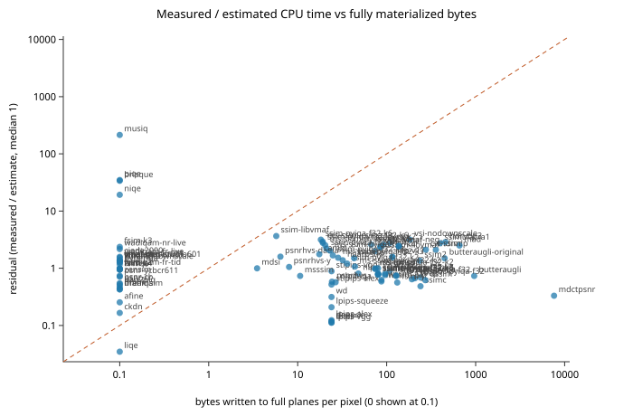

## Math

For metric m at shape W×H, each tallied stage s processes n_s elements per image, i_s images, over its pyramid levels, with c_{s,o,p} operations of class o at precision p per element. Per original pixel:

    N_{o,p}(m) = Σ_s Σ_levels i_s · n_s · c_{s,o,p} / (W·H)

A weight table assigns w_{o,p} (cycles, LLVM cost units or declared relative cost; integer precisions use the table's integer entry, other unlisted precisions its `*` entry, classes without a weight are listed as unweighted and contribute nothing):

    C(m) = Σ_{o,p} w_{o,p} · N_{o,p}(m)

Halo factors: pad = (W + 2h_x)(H + 2h_y) / (W·H); strip64 = 1 + 2h_y / 64, where h_x, h_y are the cumulative per-axis halo radii from the tallies.

Measured time per pixel: t(m) = median over repeats of (T(1+K calls) − T(1 call)) / K / (W·H), with T the `perf stat` task-clock (CPU time) or wall time of the process.

Fit: one scale k = exp(median_m(ln t(m) − ln C(m))). Residual r(m) = t(m) / (k·C(m)). Typical error = exp(median_m |ln r(m)|). Residual spread = max_m r(m) / min_m r(m). Spearman ρ = Pearson correlation of the ranks of ln C and ln t (average ranks for ties); "Pearson log" = Pearson correlation of ln C and ln t. Intervals: 2,000 bootstrap resamples of metrics with a fixed seed, 2.5th and 97.5th percentiles.

## Weight tables used

Per-operation weights exactly as used above (`scripts/complexity/weights_*.json`; each file records its source and mapping). Columns are precisions; `int` covers integer precisions; `*` is the fallback.

### flop count

Source: unweighted: one per arithmetic operation, two per fma; loads, stores, conversions and integer ops excluded

| op | f32 | f64 | int | * |
|---|---:|---:|---:|---:|
| add | – | – | – | 1 |
| mul | – | – | – | 1 |
| fma | – | – | – | 2 |
| div | – | – | – | 1 |
| rcp | – | – | – | 1 |
| sqrt | – | – | – | 1 |
| rsqrt | – | – | – | 1 |
| exp | – | – | – | 1 |
| log | – | – | – | 1 |
| pow | – | – | – | 1 |
| trig | – | – | – | 1 |
| cmp | – | – | – | 0 |
| abs | – | – | – | 0 |
| cvt | – | – | – | 0 |
| int | – | – | – | 0 |
| load | – | – | – | 0 |
| store | – | – | – | 0 |

### Pedzisz draft weights

Source: M. Pedzisz (Nokia), "Complexity Assessment of Full-Reference Image Quality Metrics", JPEG AIC-4 contribution, preliminary draft dated 2026-10-07, Table 1 (cited with the owner's permission). Mapping here: fma = mul + add = 2; rcp and rsqrt take the division and square-root weights; softplus (25) has no class in our tallies; int ops take weight 1 as baseline scalar operations; loads, stores and conversions 0 (the draft gives element copies weight 0).

| op | f32 | f64 | int | * |
|---|---:|---:|---:|---:|
| add | – | – | – | 1 |
| mul | – | – | – | 1 |
| fma | – | – | – | 2 |
| div | – | – | – | 6 |
| rcp | – | – | – | 6 |
| sqrt | – | – | – | 4 |
| rsqrt | – | – | – | 4 |
| exp | – | – | – | 20 |
| log | – | – | – | 20 |
| pow | – | – | – | 40 |
| trig | – | – | – | 20 |
| cmp | – | – | – | 1 |
| abs | – | – | – | 1 |
| cvt | – | – | – | 0 |
| int | – | – | – | 1 |
| load | – | – | – | 0 |
| store | – | – | – | 0 |

### measured i265 P-core throughput

Source: benchmarks/iqa_complexity_2026-10-17/weights/probes_i265.tsv; median of 5 perf cycle slopes; mapping add/f32=vaddss, add/f64=vaddsd, mul/f32=vmulss, mul/f64=vmulsd, fma/f32=vfmadd231ss, fma/f64=vfmadd231sd, div/f32=vdivss, div/f64=vdivsd, sqrt/f32=vsqrtss, sqrt/f64=vsqrtsd, rcp/f32=vrcpss, rsqrt/f32=vrsqrtss, cmp/f32=vminss, cmp/f64=vminsd, abs/f32=vandps_x, abs/f64=vandpd_x, cvt/f32=vcvtss2sd, cvt/f64=vcvtsd2ss, exp/f32=expf, exp/f64=exp, log/f32=logf, log/f64=log, pow/f32=powf, pow/f64=pow, trig/f32=cosf, add/integer=vpaddd_x, cmp/integer=vpaddd_x, int/integer=vpaddd_x, abs/integer=vpaddd_x, mul/integer=vpmulld_x, cvt/integer=vpmovzxbd_xx

| op | f32 | f64 | int | * |
|---|---:|---:|---:|---:|
| add | 0.4215 | 0.4212 | 0.1715 | 0.4215 |
| mul | 0.4221 | 0.4251 | 0.942 | 0.4221 |
| fma | 0.4331 | 0.4351 | – | 0.4331 |
| div | 1.9421 | 3.451 | – | 1.9421 |
| rcp | 0.9293 | – | – | 0.9293 |
| sqrt | 3.4598 | 5.9681 | – | 3.4598 |
| rsqrt | 0.9299 | – | – | 0.9299 |
| exp | 6.8654 | 9.0984 | – | 6.8654 |
| log | 7.4334 | 8.4508 | – | 7.4334 |
| pow | 12.9917 | 25.3061 | – | 12.9917 |
| trig | 5.4972 | – | – | 5.4972 |
| cmp | 0.4326 | 0.432 | 0.1715 | 0.4326 |
| abs | 0.17 | 0.171 | 0.1715 | 0.17 |
| cvt | 0.5795 | 0.5902 | 0.4222 | 0.5795 |
| int | – | – | 0.1715 | 0.1715 |

No weight (contributes nothing): load, store.

### measured i265 P-core latency

Source: benchmarks/iqa_complexity_2026-10-17/weights/probes_i265.tsv; median of 5 perf cycle slopes; mapping add/f32=vaddss, add/f64=vaddsd, mul/f32=vmulss, mul/f64=vmulsd, fma/f32=vfmadd231ss, fma/f64=vfmadd231sd, div/f32=vdivss, div/f64=vdivsd, sqrt/f32=vsqrtss, sqrt/f64=vsqrtsd, rcp/f32=vrcpss, rsqrt/f32=vrsqrtss, cmp/f32=vminss, cmp/f64=vminsd, abs/f32=vandps_x, abs/f64=vandpd_x, cvt/f32=vcvtss2sd, cvt/f64=vcvtsd2ss, exp/f32=expf, exp/f64=exp, log/f32=logf, log/f64=log, pow/f32=powf, pow/f64=pow, trig/f32=cosf, add/integer=vpaddd_x, cmp/integer=vpaddd_x, int/integer=vpaddd_x, abs/integer=vpaddd_x, mul/integer=vpmulld_x, cvt/integer=vpmovzxbd_xx

| op | f32 | f64 | int | * |
|---|---:|---:|---:|---:|
| add | 2.007 | 2.0064 | 1.0172 | 2.007 |
| mul | 3.0152 | 3.0127 | 6.2475 | 3.0152 |
| fma | 4.0398 | 4.0274 | – | 4.0398 |
| div | 7.0126 | 10.058 | – | 7.0126 |
| rcp | 4.8162 | – | – | 4.8162 |
| sqrt | 10.0761 | 15.0869 | – | 10.0761 |
| rsqrt | 4.7976 | – | – | 4.7976 |
| exp | 35.6973 | 37.3771 | – | 35.6973 |
| log | 45.9796 | 47.6085 | – | 45.9796 |
| pow | 36.0225 | 41.7208 | – | 36.0225 |
| trig | 26.5504 | – | – | 26.5504 |
| cmp | 4.0167 | 4.0317 | 1.0172 | 4.0167 |
| abs | 1.0034 | 1.011 | 1.0172 | 1.0034 |
| cvt | 5.0148 | 5.024 | 1.0164 | 5.0148 |
| int | – | – | 1.0172 | 1.0172 |

No weight (contributes nothing): load, store.

### LLVM cost model arrowlake throughput

Source: opt -passes='print<cost-model>' -cost-kind=throughput, one scalar instruction per class (scripts/complexity/llvm_cost_tables.py); abstract TTI units, libcalls use generic costs

| op | f32 | f64 | int | * |
|---|---:|---:|---:|---:|
| add | 1 | 1 | 1 | 1 |
| mul | 1 | 1 | 1 | 1 |
| fma | 1 | 1 | – | 1 |
| div | 7 | 14 | – | 7 |
| sqrt | 7 | 14 | – | 7 |
| exp | 10 | 10 | – | 10 |
| log | 10 | 10 | – | 10 |
| pow | 10 | 10 | – | 10 |
| trig | 10 | 10 | – | 10 |
| cmp | 2 | 2 | 1 | 2 |
| abs | 2 | 2 | 1 | 2 |
| cvt | 1 | 1 | 0 | 1 |
| int | – | – | – | 1 |
| load | 1 | 1 | – | 1 |
| store | 1 | 1 | – | 1 |

No weight (contributes nothing): rcp, rsqrt.

### LLVM cost model arrowlake latency

Source: opt -passes='print<cost-model>' -cost-kind=latency, one scalar instruction per class (scripts/complexity/llvm_cost_tables.py); abstract TTI units, libcalls use generic costs

| op | f32 | f64 | int | * |
|---|---:|---:|---:|---:|
| add | 4 | 4 | 1 | 4 |
| mul | 5 | 5 | 4 | 5 |
| fma | 1 | 1 | – | 1 |
| div | 13 | 20 | – | 13 |
| sqrt | 15 | 21 | – | 15 |
| exp | 10 | 10 | – | 10 |
| log | 10 | 10 | – | 10 |
| pow | 10 | 10 | – | 10 |
| trig | 10 | 10 | – | 10 |
| cmp | 7 | 7 | 1 | 7 |
| abs | 2 | 2 | 2 | 2 |
| cvt | 1 | 1 | 0 | 1 |
| int | – | – | – | 1 |
| load | 4 | 4 | – | 4 |
| store | 1 | 1 | – | 1 |

No weight (contributes nothing): rcp, rsqrt.

### llvm-mca arrowlake (ADLP) throughput

Source: benchmarks/iqa_complexity_2026-10-17/weights/llvm_mca_arrowlake.tsv; scalar instruction per class; libm calls absent from mca

| op | f32 | f64 | int | * |
|---|---:|---:|---:|---:|
| add | 0.5 | 0.5 | 0.33 | 0.5 |
| mul | 0.5 | 0.5 | 1 | 0.5 |
| fma | 0.5 | 0.5 | – | 0.5 |
| div | 1 | 1 | – | 1 |
| rcp | 1 | – | – | 1 |
| sqrt | 1 | 1 | – | 1 |
| rsqrt | 1 | – | – | 1 |
| cmp | 0.5 | 0.5 | 0.33 | 0.5 |
| abs | – | – | 0.33 | 0.33 |
| cvt | 1 | 1 | 0.5 | 1 |
| int | – | – | 0.33 | 0.33 |

No weight (contributes nothing): exp, log, pow, trig, load, store.

### LLVM cost model znver5 throughput (other CPU)

Source: opt -passes='print<cost-model>' -cost-kind=throughput, one scalar instruction per class (scripts/complexity/llvm_cost_tables.py); abstract TTI units, libcalls use generic costs

| op | f32 | f64 | int | * |
|---|---:|---:|---:|---:|
| add | 1 | 1 | 1 | 1 |
| mul | 1 | 1 | 1 | 1 |
| fma | 1 | 1 | – | 1 |
| div | 3 | 4 | – | 3 |
| sqrt | 3 | 6 | – | 3 |
| exp | 10 | 10 | – | 10 |
| log | 10 | 10 | – | 10 |
| pow | 10 | 10 | – | 10 |
| trig | 10 | 10 | – | 10 |
| cmp | 2 | 2 | 1 | 2 |
| abs | 2 | 2 | 1 | 2 |
| cvt | 1 | 1 | 0 | 1 |
| int | – | – | – | 1 |
| load | 1 | 1 | – | 1 |
| store | 1 | 1 | – | 1 |

No weight (contributes nothing): rcp, rsqrt.

## Limits

- One host, one shape, one content pair. Nothing here ranks metrics across hosts.
- The rank correlations are dominated by the three-decade spread between the cheapest and most expensive metrics; the residual spread is the within-range error.
- Per-pixel estimates ignore vectorization, cache behaviour and threading, which the measured times include.
- Halo factors are modelling assumptions, not measured overheads.
- Several neural tallies fail a physical bound: their counted flops divided by measured single-thread time exceed one P-core's peak of about 176 GFLOP/s (LPIPS-VGG, DISTS, DeepDC, LIQE), while MUSIQ's count is far too low; those tallies are being recounted, and the neural points are provisional until then.
- Tallies counted by one lane are provisional until the swapped recounts reconcile them.
