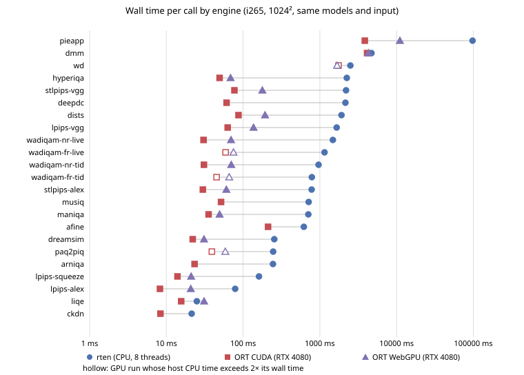

# NN metrics across engines

Generated by `scripts/complexity/nn_engines.py` from the timing tables in
`benchmarks/iqa_complexity_2026-10-17/` (method, binary and caveats: `engines/README.md`).
Same models, same 1024×1024 input pair, same 8-thread budget on i265; only the engine differs.
"CPU-bound part" marks a GPU engine whose host CPU time exceeds 2× its wall time.

DMM and PieAPP spend about as much host CPU time as wall time on both GPU engines (4.1 s and
3.9 s on CUDA), so their GPU runs are also limited by host-side work; which step is not
measured here. CUDA/WebGPU wall includes host-to-device upload of the input pair.

| model | rten wall ms | CUDA wall ms | CUDA host CPU ms | WebGPU wall ms | WebGPU host CPU ms | rten / CUDA |
|---|---:|---:|---:|---:|---:|---:|
| pieapp | 97831.2 | 3853.2 | 3853.2 | 11043.5 | 2843.6 | 25× |
| dmm | 4708.0 | 4124.7 | 4119.8 | 4302.0 | 4149.5 | 1× |
| wd | 2500.1 | 1751.1 (CPU-bound part) | 4804.4 | 1676.4 (CPU-bound part) | 4669.0 | 1× |
| hyperiqa | 2244.5 | 49.4 | 58.8 | 68.6 | 43.2 | 45× |
| stlpips-vgg | 2195.6 | 77.0 | 84.3 | 177.9 | 93.7 | 29× |
| deepdc | 2153.0 | 60.9 | 63.8 | unsupported ops | — | 35× |
| dists | 1913.0 | 87.0 | 90.2 | 193.2 | 97.9 | 22× |
| lpips-vgg | 1655.2 | 62.9 | 65.8 | 136.6 | 85.1 | 26× |
| wadiqam-nr-live | 1479.8 | 30.5 | 30.4 | 69.6 | 36.3 | 49× |
| wadiqam-fr-live | 1150.1 | 59.1 (CPU-bound part) | 1056.0 | 74.9 (CPU-bound part) | 1155.1 | 19× |
| wadiqam-nr-tid | 962.2 | 30.9 | 30.6 | 70.1 | 36.8 | 31× |
| wadiqam-fr-tid | 787.0 | 45.1 (CPU-bound part) | 675.2 | 65.8 (CPU-bound part) | 932.8 | 17× |
| stlpips-alex | 781.8 | 29.9 | 37.6 | 60.5 | 41.9 | 26× |
| musiq | 715.2 | 51.5 | 53.9 | unsupported ops | — | 14× |
| maniqa | 707.5 | 35.5 | 39.3 | 49.4 | 16.5 | 20× |
| afine | 619.1 | 211.3 | 220.6 | unsupported ops | — | 3× |
| dreamsim | 255.0 | 22.0 | 34.1 | 30.9 | 26.2 | 12× |
| paq2piq | 246.2 | 39.2 (CPU-bound part) | 689.1 | 58.6 (CPU-bound part) | 952.0 | 6× |
| arniqa | 244.9 | 23.3 | 34.7 | unsupported ops | — | 11× |
| lpips-squeeze | 161.0 | 13.9 | 21.2 | 21.0 | 24.1 | 12× |
| lpips-alex | 78.9 | 8.2 | 11.1 | 20.8 | 26.6 | 10× |
| liqe | 24.9 | 15.6 | 15.6 | 31.0 | 13.5 | 2× |
| ckdn | 21.4 | 8.4 | 13.4 | unsupported ops | — | 3× |
